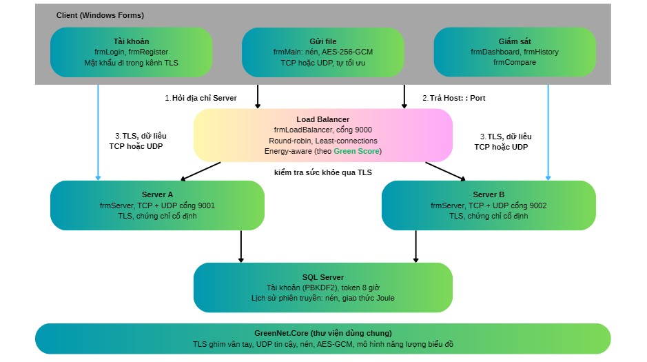
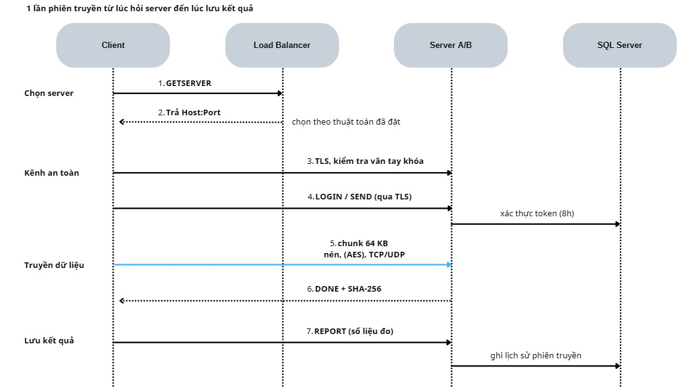

# GreenNet – Đo và tối ưu năng lượng truyền tải dữ liệu

Đồ án môn Lập trình mạng căn bản – C# .NET 8, Windows Forms.

GreenNet là hệ thống client–server dùng để **đo, so sánh và tối ưu năng lượng** khi truyền dữ liệu qua mạng.
Việc gửi file chỉ là khối lượng công việc (workload) để có thứ cần đo: cùng một file được gửi nhiều lần với
các cấu hình khác nhau (nén, mã hóa, giao thức) rồi so sánh công bằng.

## Mục lục

1. [Mục đích và ứng dụng](#1-mục-đích-và-ứng-dụng)
2. [Kiến trúc](#2-kiến-trúc)
3. [Tính năng](#3-tính-năng)
4. [Cấu trúc thư mục](#4-cấu-trúc-thư-mục)
5. [Cài đặt và chạy](#5-cài-đặt-và-chạy)
6. [Hướng dẫn sử dụng](#6-hướng-dẫn-sử-dụng)
7. [Bảo mật](#7-bảo-mật)
8. [Hiệu chỉnh mô hình năng lượng](#8-hiệu-chỉnh-mô-hình-năng-lượng)
9. [Giao thức](#9-giao-thức)
10. [Giới hạn](#10-giới-hạn)

## 1. Mục đích và ứng dụng

**Bài toán.** Truyền dữ liệu tiêu tốn năng lượng ở CPU (nén, mã hóa), card mạng (gửi gói) và hạ tầng mạng.
Nén mạnh giảm số byte phải gửi nhưng tốn thêm CPU; không nén thì ngược lại. Cấu hình nào tiết kiệm nhất
phụ thuộc vào loại dữ liệu và điều kiện mạng.

**Mục tiêu.**

- Đo số byte, thời gian, RTT, CPU và năng lượng ước tính (Joule) của từng phiên truyền.
- So sánh các cấu hình: nén (None, Gzip, Brotli, Zstd), mã hóa AES, giao thức TCP hoặc UDP.
- Tự tối ưu: chọn thuật toán nén tiết kiệm nhất theo từng đoạn dữ liệu và giảm tốc khi công suất vượt ngưỡng.
- Trực quan hóa bằng dashboard, lịch sử, bảng so sánh và điểm tổng hợp _Green Score_ (0–100).

**Ứng dụng hiện tại.**

- Công cụ học và thực nghiệm về lập trình mạng, bảo mật và hiệu quả năng lượng.
- Hỗ trợ quyết định cho các tác vụ truyền dữ liệu hàng loạt (sao lưu, đồng bộ, gửi log): nên nén hay không, dùng thuật toán nào.
- Minh họa cân bằng tải có xét năng lượng (Energy-aware) thay vì chỉ chia đều số kết nối.

**Hướng mở rộng.**

- Tính phát thải carbon (gCO₂e) bằng cách nhân năng lượng với cường độ carbon của điện theo vùng và giờ,
  hướng tới cách tính của chuẩn Software Carbon Intensity (ISO/IEC 21031:2024).
- Lên lịch truyền khi lưới điện "xanh" hơn, chọn server theo vùng có carbon thấp.
- Thiết bị dùng pin và IoT; thêm HTTP/3 (QUIC); dự đoán thuật toán nén bằng ML.NET; đo năng lượng bằng RAPL.

> Đây là nguyên mẫu học thuật: giá trị chính là phương pháp đo và so sánh, chưa phải sản phẩm triển khai thật.

## 2. Kiến trúc



| Thành phần                | Vai trò                                                                              |
| ------------------------- | ------------------------------------------------------------------------------------ |
| **GreenNet.Client**       | Đăng ký/đăng nhập, gửi file, dashboard, lịch sử, so sánh                             |
| **GreenNet.LoadBalancer** | Trả về địa chỉ server phù hợp; kiểm tra sức khỏe server mỗi 2 giây                   |
| **GreenNet.Server**       | Nhận file, xác thực người dùng, ghi kết quả vào CSDL (chạy 2 bản để có Multi Server) |
| **SQL Server**            | Lưu người dùng (mật khẩu đã băm), token và lịch sử phiên                             |
| **GreenNet.Core**         | Thư viện dùng chung của cả ba ứng dụng                                               |

Load Balancer chỉ chỉ đường, không nhận dữ liệu file nên không thành điểm nghẽn.
Thuật toán phân phối: Round-robin, Least-connections, Energy-aware (chọn server có `Green Score / (1 + số client)` lớn nhất).

**Luồng một phiên truyền.**



## 3. Tính năng

- **Hai giao thức truyền.** TCP (cùng kênh TLS) hoặc UDP tin cậy (gói 1200 byte, cửa sổ 64 gói, ACK tích lũy kèm bitmap, tự gửi lại).
  UDP bắt buộc bật AES-256-GCM nên so sánh TCP(TLS) với UDP(AES) là công bằng.
- **Nén theo từng chunk.** None, Gzip, Brotli, Zstd; mỗi chunk mang mã thuật toán nên server giải nén đúng dù thuật toán đổi giữa chừng.
- **Tự tối ưu.** Thử lần lượt các thuật toán, đo năng lượng ước tính trên mỗi byte rồi chọn thấp nhất (thử lại định kỳ);
  nếu công suất ước tính vượt ngưỡng (W) thì tăng dần độ trễ giữa các chunk và ưu tiên thuật toán ít tốn CPU.
- **Đo lường.** RTT, CPU, byte, thời gian, năng lượng ước tính, Green Score, kiểm tra SHA-256 toàn file.
- **Giao diện.** Dashboard thời gian thực có cảnh báo ngưỡng năng lượng, lịch sử có lọc theo ngày và xuất CSV, bảng so sánh có % tiết kiệm.
- **Tài khoản.** Mật khẩu băm PBKDF2-SHA256 có muối; phiên đăng nhập bằng token hạn 8 giờ.

## 4. Cấu trúc thư mục

```
GreenNet.sln
nuget.config
GreenNet.Core/            Thư viện dùng chung
GreenNet.Client/          frmLogin, frmRegister, frmMain, frmDashboard, frmHistory, frmCompare
GreenNet.Server/          frmServer
GreenNet.LoadBalancer/    frmLoadBalancer
db/                       Schema.sql, Migration_v2.sql
tools/                    fit_energy_model.py, runs_template.csv
docs/                     HuongDan_HieuChinh_NangLuong.md
```

## 5. Cài đặt và chạy

**Yêu cầu:** Windows 10/11, .NET 8 SDK (Visual Studio 2022 17.8 trở lên), SQL Server (Express hoặc LocalDB),
truy cập được nuget.org để tải `Microsoft.Data.SqlClient` và `ZstdSharp.Port`.
Python 3 với numpy và scipy chỉ cần cho công cụ hiệu chỉnh.

1. **Tạo CSDL:** chạy `db/Schema.sql` trong SQL Server Management Studio.
   Nếu database đã có từ trước và thiếu cột `Protocol`, chạy `db/Migration_AddProtocol.sql`.
2. **Mở và build:** mở `GreenNet.sln`, khôi phục gói NuGet rồi Build.
   (`GreenNet.Core` là thư viện nên không chạy trực tiếp; chọn Server, Load Balancer và Client làm dự án khởi chạy.)
3. **Tường lửa:** mở **TCP và UDP** cho cổng 9001 và 9002; mở TCP cho cổng 9000.
4. **Khởi động theo thứ tự:**
   1. **Server A** (cổng 9001) và **Server B** (cổng 9002): nhập chuỗi kết nối SQL, nhấn Start. Ghi lại _vân tay khóa_ hiển thị trên màn hình.
   2. **Load Balancer** (cổng 9000): danh sách đã có sẵn hai server; chọn thuật toán, nhấn Start. Khoảng 2 giây sau cột Online chuyển thành đúng.
   3. **Client**: nhập địa chỉ và cổng Load Balancer, đăng ký rồi đăng nhập.

Khi demo nhiều máy, thay `127.0.0.1` bằng IP thật trong frmLoadBalancer (mục Thêm server).

## 6. Hướng dẫn sử dụng

| Form                | Cách dùng                                                                                                                                                                                           |
| ------------------- | --------------------------------------------------------------------------------------------------------------------------------------------------------------------------------------------------- |
| **frmLogin**        | Nhập địa chỉ/cổng Load Balancer, tên đăng nhập, mật khẩu. Có nút sang đăng ký                                                                                                                       |
| **frmRegister**     | Tên đăng nhập 3–30 ký tự (chữ, số, dấu `_`); mật khẩu 6–40 ký tự, nhập lại để xác nhận                                                                                                              |
| **frmMain**         | Chọn file; chọn TCP hoặc UDP; chọn thuật toán nén hoặc bật _Tự tối ưu_ (kèm ngưỡng công suất W); bật/tắt AES; nhấn Gửi file và theo dõi tiến trình, RTT, năng lượng, Green Score, kiểm tra toàn vẹn |
| **frmDashboard**    | Biểu đồ tốc độ, CPU, năng lượng tích lũy theo thời gian thực; đặt ngưỡng cảnh báo (J); xem nén hiện tại, công suất và độ trễ giảm tốc                                                               |
| **frmHistory**      | Xem các phiên đã lưu, lọc theo ngày, xuất CSV                                                                                                                                                       |
| **frmCompare**      | Chọn một file cụ thể và một chỉ số để so sánh các cấu hình; có cột % tiết kiệm so với mốc _None (TCP)_                                                                                              |
| **frmServer**       | Đặt tên, cổng, chuỗi kết nối SQL; Start/Stop; xem vân tay khóa, số client, nhật ký                                                                                                                  |
| **frmLoadBalancer** | Thêm/xóa server, chọn thuật toán, Start/Stop; xem trạng thái, vân tay khóa, số lần phân phối; nút _Quên khóa_ khi server đổi khóa hợp lệ                                                            |

**Kịch bản thực nghiệm gợi ý:** gửi cùng một file với nhiều cấu hình (mỗi cấu hình lặp ít nhất 5 lần), thử cả file dễ nén
(văn bản, CSV) và khó nén (ZIP, video); so TCP với UDP (có thể thêm mất gói bằng `clumsy` hoặc `tc netem`);
so chế độ Tự tối ưu với cấu hình cố định tốt nhất; chạy nhiều client để so ba thuật toán cân bằng tải.
Xem kết quả ở frmCompare và xuất CSV từ frmHistory để thống kê.

## 7. Bảo mật

| Mối đe dọa                         | Biện pháp                                                                                        |
| ---------------------------------- | ------------------------------------------------------------------------------------------------ |
| Nghe lén mật khẩu và token         | Mọi kết nối tới server dùng TLS 1.2/1.3                                                          |
| Giả mạo server (man-in-the-middle) | Mỗi server có chứng chỉ tự ký cố định, client **ghim vân tay SHA-256** (giống SSH `known_hosts`) |
| Lộ mật khẩu trong CSDL             | PBKDF2-SHA256 có muối                                                                            |
| Đọc/sửa dữ liệu UDP                | AES-256-GCM từng chunk và SHA-256 toàn file                                                      |
| Tải lên độc hại                    | Giới hạn kích thước, chặn dữ liệu giải nén vượt mức, làm sạch tên file                           |
| Dò mật khẩu                        | Làm chậm 0,5 giây sau mỗi lần đăng nhập sai                                                      |

**Cách ghim khóa.** Lần đầu kết nối tới một server, hộp thoại hiện vân tay; bạn đối chiếu với màn hình frmServer rồi mới chọn Yes.
Các lần sau, nếu vân tay khác, kết nối bị chặn kèm cảnh báo. Kho khóa nằm ở `%LOCALAPPDATA%\GreenNet\known_servers.client.json`,
chứng chỉ của server nằm ở `%LOCALAPPDATA%\GreenNet\identity`.
Để minh họa: xóa file `.pfx` của server rồi khởi động lại; client sẽ từ chối.

**Giới hạn bảo mật:** độ tin cậy ở lần đầu phụ thuộc việc bạn thực sự đối chiếu vân tay; kênh Client–Load Balancer không bí mật
(kẻ chen giữa vẫn không giả được server vì thiếu khóa riêng); khóa riêng của server lưu không mật khẩu trong hồ sơ người dùng Windows;
header gói UDP không được xác thực riêng (kẻ chen giữa chỉ phá được phiên, không đọc hay sửa được nội dung).

## 8. Hiệu chỉnh mô hình năng lượng

Mô hình chỉ tính **máy đầu cuối chạy Client** (CPU tăng thêm và giao diện mạng), không tính router, mạng lõi hay trung tâm dữ liệu:

```
E = P_cpu × t_cpu + e_byte × số_byte
```

Hằng số mặc định chỉ là giá trị khởi đầu. Trước khi dùng con số Joule tuyệt đối, hãy đo thật và hiệu chỉnh:

1. Đo công suất nghỉ và năng lượng của ít nhất 20 lần chạy bằng ổ cắm đo điện (xem `docs/HuongDan_HieuChinh_NangLuong.md`).
2. Chạy `python tools/fit_energy_model.py runs.csv --idle-w <W> --device "<thiết bị>" --method "<phương pháp>"` (mẫu dữ liệu: `tools/runs_template.csv`).
3. Chép `energy_calibration.json` được tạo ra cạnh file `.exe` của Client; nhật ký ở frmMain sẽ ghi rõ mô hình đã hiệu chỉnh.
4. Kiểm chứng trên vài kịch bản không dùng khi hồi quy và báo cáo sai số.

Khi chưa hiệu chỉnh, chỉ nên kết luận theo hướng so sánh tương đối giữa các cấu hình.

## 9. Giao thức

- **Khung gói:** 4 byte độ dài (big-endian) + dữ liệu; độ dài 0 là gói kết thúc.
- **Kênh điều khiển (TLS, JSON):** PING/PONG, STATUS, REGISTER, LOGIN, HISTORY, SEND, DONE, REPORT.
  Riêng GETSERVER (client với Load Balancer) không qua TLS vì chỉ trả địa chỉ.
- **Truyền file:** SEND (giao thức, thuật toán, khóa AES, mã phiên UDP) → các chunk 64 KB, mỗi chunk gồm
  `[mã nén 1 byte][dữ liệu nén]`, mã hóa AES-GCM nếu bật → gói rỗng → DONE kèm SHA-256.
- **UDP tin cậy:** DATA/FIN = `[loại 1B][session 8B][seq 4B][payload ≤ 1200B]`; ACK = `[3][session 8B][cum 4B][bitmap 8B]`.
  Cổng UDP trùng cổng TCP của server.

## 10. Giới hạn

- Hằng số năng lượng chưa có ý nghĩa tuyệt đối cho tới khi bạn hiệu chỉnh.
- CPU đo theo toàn tiến trình Client (gồm giao diện); chi phí TLS không tách riêng.
- Giảm tốc giữ công suất đỉnh dưới ngưỡng nhưng mô hình không tính năng lượng nghỉ, nên không nhất thiết giảm tổng năng lượng;
  phần tiết kiệm đến từ việc chọn thuật toán nén.
- UDP chỉ hỗ trợ IPv4 và chưa có kiểm soát tắc nghẽn: phù hợp mạng LAN và thí nghiệm. Logic UDP mới được kiểm bằng mô phỏng, cần thử thêm trên mạng thật.
- Chỉ truyền file; chưa có luồng video hoặc âm thanh.
- Mã nguồn cần được biên dịch và kiểm thử đầy đủ trên máy thật trước khi nộp hoặc triển khai.
